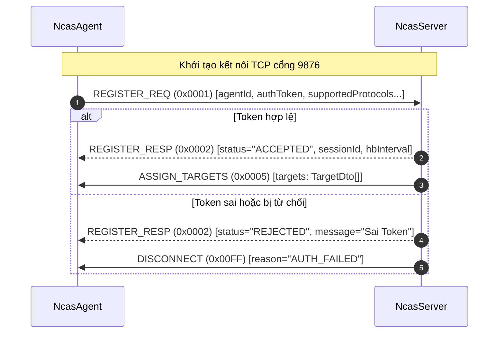
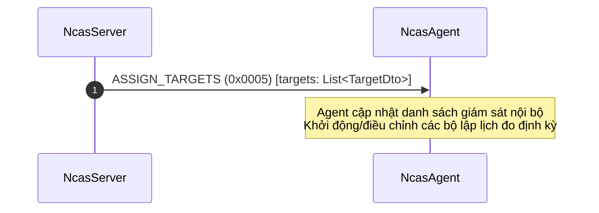
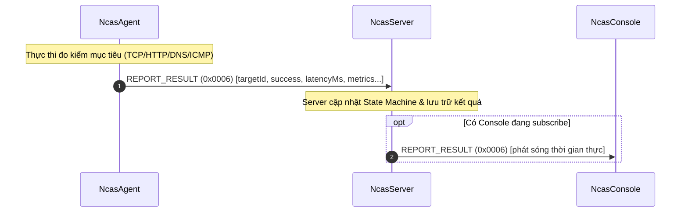
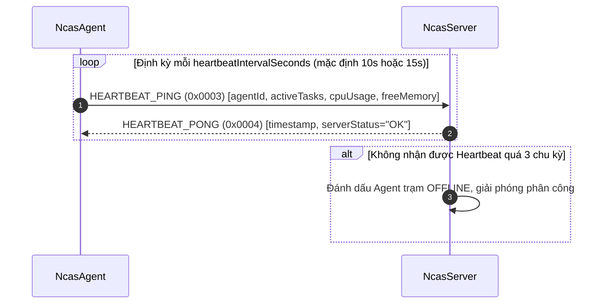
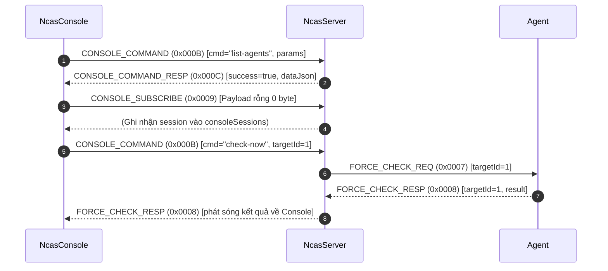

# ĐẶC TẢ GIAO THỨC NCAS-P v1 (ĐÃ ĐÓNG BĂNG)

> **Trạng thái:** `FROZEN` (Đã đóng băng tại Task **T0.2** — Phase 0).  
> **Nguyên tắc:** Tài liệu này phản ánh chính xác 100% hiện trạng nhị phân của giao thức NCAS-P v1 trong mã nguồn. Toàn bộ các vector mẫu trong `src/test/resources/protocol/golden/` là bất biến và đóng vai trò làm chốt chặn kiểm thử hồi quy (Regression Guard) cho các nâng cấp v1.1 ở Phase 1.

---

## 1. Tổng Quan Giao Thức

NCAS-P v1 (Network Connection Alert System Protocol version 1) là giao thức truyền thông nhị phân tầng ứng dụng chạy trên nền kết nối socket TCP hai chiều (full-duplex). Giao thức được thiết kế để kết nối giữa Máy chủ trung tâm (`NcasServer`), các Trạm kiểm định phân tán (`NcasAgent`), và Trình quản trị dòng lệnh (`NcasConsole`).

### 1.1. Các đặc tính cốt lõi
* **Mô hình đóng khung (Framing):** Dựa trên chiều dài cố định ở Header kết hợp thân Payload động (Length-prefixed binary framing).
* **Định dạng dữ liệu:** Thân gói tin (Payload) là chuỗi văn bản JSON mã hóa UTF-8.
* **Thứ tự byte mạng (Endianness):** Big-Endian (Network Byte Order) cho toàn bộ các trường số nguyên trong Header và Checksum.
* **Kiểm soát toàn vẹn ứng dụng:** Sử dụng thuật toán CRC32 IEEE 802.3 tính riêng trên mảng byte của Payload.
* **Cơ chế chống phân mảnh và dính gói:** Tầng giải mã bắt buộc phải tích lũy đủ số byte theo trường `Length` trước khi xử lý (sử dụng vòng lặp `readFully`).

---

## 2. Cấu Trúc Khung Truyền Nhị Phân (Binary Frame Format)

Mỗi khung truyền (Frame / Protocol Data Unit - PDU) của NCAS-P v1 gồm 3 thành phần liên tiếp:
1. **Header cố định:** 11 bytes.
2. **Payload thân gói:** `N` bytes (UTF-8 JSON, với $0 \le N \le 16.777.216$).
3. **Trailer kiểm tra toàn vẹn:** 4 bytes CRC32.

Tổng kích thước gói tin: $\text{TotalLength} = 11 + N + 4 = N + 15 \text{ bytes}$.

```
+--------------------+---------------+--------------------+---------------------+-----------------------+--------------------+
| Magic Bytes (4B)   | Version (1B)  | Message Type (2B)  | Payload Length (4B) | Payload Body (N bytes)| CRC32 Checksum (4B)|
| 'N', 'C', 'A', 'S' | 0x01          | short (0x0001..FF) | int (0..16,777,216) | JSON (UTF-8 encoded)  | IEEE 802.3 CRC32   |
+--------------------+---------------+--------------------+---------------------+-----------------------+--------------------+
0                    4               5                    7                     11                      11+N               15+N
```

### 2.1. Bảng Phân Rã Byte Header (11 Bytes Offset Table)

| Offset (Byte) | Trường | Độ dài | Kiểu dữ liệu | Giá trị quy định / Phạm vi | Ý nghĩa & Mô tả kỹ thuật |
|:---:|:---|:---:|:---:|:---|:---|
| **0 .. 3** | `Magic Bytes` | 4 bytes | `byte[4]` | `0x4E 0x43 0x41 0x53` (`'N'`, `'C'`, `'A'`, `'S'`) | Đồng bộ ranh giới khung. Nếu nhận sai, kết nối bị đóng ngay. |
| **4** | `Version` | 1 byte | `uint8` | `0x01` | Phiên bản giao thức hiện tại là v1. Bắt buộc từ chối nếu $\ne 0x01$. |
| **5 .. 6** | `MessageType` | 2 bytes | `int16` (short) | `0x0001` .. `0x000C`, `0x00FF` | Mã định danh loại thông điệp (Big-Endian). |
| **7 .. 10** | `PayloadLength`| 4 bytes | `int32` (int) | $0 \le \text{length} \le 16.777.216$ ($16\text{ MiB}$) | Chiều dài byte của thân Payload JSON (Big-Endian). |

### 2.2. Payload Body & Phạm Vi CRC32 Checksum

| Offset (Byte) | Trường | Độ dài | Kiểu dữ liệu | Ý nghĩa & Mô tả kỹ thuật |
|:---:|:---|:---:|:---:|:---|
| **11 .. 11+N-1** | `Payload Body` | $N$ bytes | `byte[N]` | Chuỗi JSON UTF-8 đại diện cho đối tượng DTO. Nếu $N=0$ thì không có phần thân này. |
| **11+N .. 14+N** | `CRC32 Checksum` | 4 bytes | `uint32` (int) | Mã băm toàn vẹn CRC32 chuẩn IEEE 802.3 (đa thức `0xEDB88320`). **Chỉ tính trên mảng byte của Payload Body**. Nếu $N=0$, giá trị Checksum mặc định là `0x00000000`. |

> [!IMPORTANT]
> **Quy tắc tính CRC32:** Header 11 byte **KHÔNG** nằm trong phạm vi bảo vệ của trường CRC32 trong v1. CRC32 được tính thuần túy bởi `java.util.zip.CRC32.update(payload)`.

---

## 3. Danh Mục Các Loại Thông Điệp (MessageType Catalog)

Giao thức NCAS-P v1 định nghĩa chính xác 13 mã thông điệp trong `com.networkalert.protocol.MessageType`:

| Mã (Hex) | Tên Enum | Hướng truyền | DTO Đối ứng | Ý nghĩa chức năng |
|:---:|:---|:---:|:---|:---|
| `0x0001` | `REGISTER_REQ` | Agent $\rightarrow$ Server | `RegisterRequest` | Agent bắt đầu phiên, gửi thông tin định danh và token xác thực. |
| `0x0002` | `REGISTER_RESP` | Server $\rightarrow$ Agent | `RegisterResponse` | Server phản hồi kết quả duyệt (ACCEPTED / REJECTED) kèm session ID. |
| `0x0003` | `HEARTBEAT_PING` | Agent $\rightarrow$ Server | `HeartbeatPing` | Agent gửi nhịp tim định kỳ báo cáo CPU, RAM, số task đang chạy. |
| `0x0004` | `HEARTBEAT_PONG` | Server $\rightarrow$ Agent | `HeartbeatPong` *(hoặc rỗng)* | Server phản hồi duy trì kết nối keepalive. |
| `0x0005` | `ASSIGN_TARGETS` | Server $\rightarrow$ Agent | `AssignTargetsMessage` | Server phân bổ danh sách các mục tiêu cần đo cho Agent. |
| `0x0006` | `REPORT_RESULT` | Agent $\rightarrow$ Server | `ReportResultMessage` | Agent gửi kết quả đo kiểm mạng từng lần về trung tâm. |
| `0x0007` | `FORCE_CHECK_REQ` | Server $\rightarrow$ Agent | `ForceCheckRequest` | Server yêu cầu Agent kiểm tra tức thời 1 mục tiêu chỉ định. |
| `0x0008` | `FORCE_CHECK_RESP` | Agent $\rightarrow$ Server | `ForceCheckResponse` | Agent trả về kết quả đo tức thời. |
| `0x0009` | `CONSOLE_SUBSCRIBE` | Console $\rightarrow$ Server | *(Không có payload - 0 byte)* | Console đăng ký nhận luồng phát sóng thời gian thực. |
| `0x000A` | `CONSOLE_EVENT_STREAM` | Server $\rightarrow$ Console | *(Chuỗi JSON sự kiện)* | Kênh phát sóng sự kiện chuyển trạng thái & cảnh báo tới Console. |
| `0x000B` | `CONSOLE_COMMAND` | Console $\rightarrow$ Server | `ConsoleCommand` | Console gửi lệnh quản trị CLI (list-agents, list-targets, check-now...). |
| `0x000C` | `CONSOLE_COMMAND_RESP` | Server $\rightarrow$ Console | `ConsoleResponse` | Server phản hồi kết quả thực thi lệnh CLI. |
| `0x00FF` | `DISCONNECT` | Cả hai chiều | `DisconnectMessage` | Thông báo ngắt kết nối an toàn (EOF chủ động kèm lý do). |

---

## 4. Đặc Tả DTO & JSON Schemas

Toàn bộ payload của các thông điệp có nội dung đều được serialize/deserialize thông qua thư viện `com.google.code.gson.Gson`.

### 4.1. `RegisterRequest` (`0x0001`)
```json
{
  "$schema": "http://json-schema.org/draft-07/schema#",
  "title": "RegisterRequest",
  "type": "object",
  "properties": {
    "agentId": { "type": "string" },
    "hostname": { "type": "string" },
    "os": { "type": "string" },
    "localIp": { "type": "string" },
    "macAddress": { "type": "string" },
    "authToken": { "type": "string" },
    "supportedProtocols": { "type": "array", "items": { "type": "string" } },
    "version": { "type": "string" }
  },
  "required": ["agentId", "authToken", "supportedProtocols"]
}
```

### 4.2. `RegisterResponse` (`0x0002`)
> [!NOTE]
> Tên chính thức trong mã nguồn là **`REGISTER_RESP`** (mã `0x0002`), không phải `REGISTER_ACK`.
```json
{
  "$schema": "http://json-schema.org/draft-07/schema#",
  "title": "RegisterResponse",
  "type": "object",
  "properties": {
    "status": { "type": "string", "enum": ["ACCEPTED", "REJECTED"] },
    "assignedSessionId": { "type": ["string", "null"] },
    "heartbeatIntervalSeconds": { "type": "integer" },
    "serverTime": { "type": "integer" },
    "message": { "type": ["string", "null"] },
    "dedicatedSecret": { "type": ["string", "null"] }
  },
  "required": ["status", "serverTime"]
}
```

### 4.3. `HeartbeatPing` (`0x0003`)
```json
{
  "$schema": "http://json-schema.org/draft-07/schema#",
  "title": "HeartbeatPing",
  "type": "object",
  "properties": {
    "agentId": { "type": "string" },
    "timestamp": { "type": "integer" },
    "activeTasks": { "type": "integer" },
    "cpuUsagePercent": { "type": "number" },
    "freeMemoryMb": { "type": "integer" }
  },
  "required": ["agentId", "timestamp"]
}
```

### 4.4. `HeartbeatPong` (`0x0004`)
> [!NOTE]
> `HEARTBEAT_PONG` có thể gửi kèm DTO `HeartbeatPong` hoặc gửi dưới dạng Frame rỗng (Payload 0 byte, Checksum = 0).
```json
{
  "$schema": "http://json-schema.org/draft-07/schema#",
  "title": "HeartbeatPong",
  "type": "object",
  "properties": {
    "timestamp": { "type": "integer" },
    "serverStatus": { "type": "string" }
  }
}
```

### 4.5. `AssignTargetsMessage` (`0x0005`) & `TargetDto`
```json
{
  "$schema": "http://json-schema.org/draft-07/schema#",
  "title": "AssignTargetsMessage",
  "type": "object",
  "properties": {
    "targets": {
      "type": "array",
      "items": {
        "type": "object",
        "properties": {
          "id": { "type": "integer" },
          "name": { "type": "string" },
          "host": { "type": "string" },
          "port": { "type": "integer" },
          "protocol": { "type": "string" },
          "intervalSeconds": { "type": "integer" },
          "timeoutMs": { "type": "integer" },
          "warningThresholdMs": { "type": "integer" },
          "enabled": { "type": "boolean" },
          "scope": { "type": "string", "enum": ["SERVER", "AGENT", "MULTI"] },
          "group": { "type": "string" },
          "tags": { "type": "string" }
        },
        "required": ["id", "name", "host", "protocol"]
      }
    },
    "timestamp": { "type": "integer" }
  }
}
```

### 4.6. `ReportResultMessage` (`0x0006`) & `MetricBreakdownDto`
```json
{
  "$schema": "http://json-schema.org/draft-07/schema#",
  "title": "ReportResultMessage",
  "type": "object",
  "properties": {
    "agentId": { "type": "string" },
    "targetId": { "type": "integer" },
    "timestamp": { "type": "integer" },
    "success": { "type": "boolean" },
    "latencyMs": { "type": "integer" },
    "responseCode": { "type": "integer" },
    "metrics": {
      "type": ["object", "null"],
      "properties": {
        "dnsLookupMs": { "type": "integer" },
        "tcpConnectMs": { "type": "integer" },
        "tlsHandshakeMs": { "type": "integer" },
        "ttfbMs": { "type": "integer" }
      }
    },
    "message": { "type": "string" }
  },
  "required": ["agentId", "targetId", "timestamp", "success", "latencyMs"]
}
```

### 4.7. `ForceCheckRequest` (`0x0007`) & `ForceCheckResponse` (`0x0008`)
* `ForceCheckRequest`:
```json
{
  "type": "object",
  "properties": {
    "targetId": { "type": "integer" },
    "target": { "$ref": "#/definitions/TargetDto" },
    "requestedAt": { "type": "integer" }
  },
  "required": ["targetId"]
}
```
* `ForceCheckResponse`:
```json
{
  "type": "object",
  "properties": {
    "targetId": { "type": "integer" },
    "result": { "$ref": "#/definitions/ReportResultMessage" }
  },
  "required": ["targetId", "result"]
}
```

### 4.8. `ConsoleCommand` (`0x000B`) & `ConsoleResponse` (`0x000C`)
* `ConsoleCommand`:
```json
{
  "type": "object",
  "properties": {
    "command": { "type": "string" },
    "params": { "type": "object", "additionalProperties": { "type": "string" } },
    "timestamp": { "type": "integer" }
  },
  "required": ["command"]
}
```
* `ConsoleResponse`:
```json
{
  "type": "object",
  "properties": {
    "success": { "type": "boolean" },
    "message": { "type": "string" },
    "dataJson": { "type": ["string", "null"] },
    "executionTimeMs": { "type": "integer" }
  },
  "required": ["success", "message"]
}
```

### 4.9. `DisconnectMessage` (`0x00FF`)
```json
{
  "type": "object",
  "properties": {
    "reason": { "type": "string" },
    "details": { "type": "string" },
    "timestamp": { "type": "integer" }
  },
  "required": ["reason"]
}
```

---

## 5. Hành Vi Parser & Khả Năng Tương Thích Trường Mở Rộng

Xác minh kỹ thuật thực tế trên tầng mã nguồn của `FrameDecoder` và `Frame`:
1. **Tầng nhị phân (Binary Frame Layer):**
   - Header bắt buộc đúng kích thước 11 byte.
   - Bắt buộc kiểm tra `Magic Bytes == "NCAS"`.
   - Bắt buộc `Version == 0x01`.
   - Bắt buộc $0 \le \text{PayloadLength} \le 16.777.216$.
   - Bắt buộc `CRC32(payload) == receivedChecksum`. Sai lệch dù chỉ 1 bit sẽ bị ngắt kết nối và ném `ProtocolException`.
2. **Tầng ứng dụng JSON (JSON Application Layer):**
   - `Frame.getPayloadAs(Class<T>)` sử dụng đối tượng `com.google.code.gson.Gson` tiêu chuẩn (`new GsonBuilder().create()`).
   - **Xác nhận:** `Gson` **BỎ QUA (IGNORE)** tất cả các trường lạ (unknown fields) có trong JSON mà không khai báo trong Java DTO, không ném ngoại lệ (`testV1DecoderIgnoresUnknownFields` trong `ProtocolGoldenTest` đã xác minh xanh 100%).
   - **Hệ quả cho nâng cấp v1.1:** Server hoặc Agent mới có thể bổ sung các trường tùy chọn (như `protoMax`, `streamId`, `seq`, `ack`) vào payload JSON mà client v1 cũ vẫn giải mã được bình thường.

---

## 6. Sơ Đồ Trình Tự Tương Tác (Sequence Diagrams)

### 6.1. Trình Tự 1: Đăng Ký Danh Tính Agent (Agent Enrollment & Registration)


### 6.2. Trình Tự 2: Phân Công Mục Tiêu Giám Sát (Target Assignment)


### 6.3. Trình Tự 3: Báo Cáo Kết Quả Đo Kiểm Định Kỳ (Result Reporting)


### 6.4. Trình Tự 4: Nhịp Tim Keepalive (Heartbeat)


### 6.5. Trình Tự 5: Quản Trị Console CLI & Event Stream


---

## 7. Bảng Vector Mẫu Chuẩn (Golden Hex Vectors)

Toàn bộ 13 file vector mẫu được lưu trữ tại `src/test/resources/protocol/golden/` và được kiểm định bởi `ProtocolGoldenTest.java`:

| File Vector | MessageType | Byte Code | Chiều dài nhị phân (bytes) | Ghi chú payload |
|:---|:---:|:---:|:---:|:---|
| `01_register_req.hex` | `REGISTER_REQ` | `0x0001` | 256 B | Đầy đủ 8 trường định danh và mảng giao thức |
| `02_register_resp.hex` | `REGISTER_RESP` | `0x0002` | 219 B | ACCEPTED kèm sessionId và dedicatedSecret |
| `03_heartbeat_ping.hex` | `HEARTBEAT_PING` | `0x0003` | 124 B | Thông số CPU (12.5%), tasks (4), free RAM |
| `04_heartbeat_pong.hex` | `HEARTBEAT_PONG` | `0x0004` | 62 B | JSON `{"timestamp":..., "serverStatus":"OK"}` |
| `05_assign_targets.hex` | `ASSIGN_TARGETS` | `0x0005` | 478 B | 2 Target mẫu (HTTP Gateway & Google DNS) |
| `06_report_result.hex` | `REPORT_RESULT` | `0x0006` | 229 B | Báo cáo HTTP 200 kèm MetricBreakdownDto |
| `07_force_check_req.hex` | `FORCE_CHECK_REQ` | `0x0007` | 284 B | Yêu cầu đo tức thời kèm TargetDto |
| `08_force_check_resp.hex` | `FORCE_CHECK_RESP` | `0x0008` | 264 B | Trả về kết quả đo tức thời |
| `09_console_subscribe.hex` | `CONSOLE_SUBSCRIBE` | `0x0009` | 15 B | Payload rỗng: Header 11B + Checksum 0x00000000 |
| `0a_console_event_stream.hex` | `CONSOLE_EVENT_STREAM`| `0x000A` | 183 B | JSON event chuẩn: `STATE_CHANGE` |
| `0b_console_command.hex` | `CONSOLE_COMMAND` | `0x000B` | 108 B | Lệnh `list-agents` kèm bộ lọc `filter=active` |
| `0c_console_command_resp.hex`| `CONSOLE_COMMAND_RESP`| `0x000C` | 152 B | Kết quả trả về kèm `dataJson` mảng Agent |
| `ff_disconnect.hex` | `DISCONNECT` | `0x00FF` | 109 B | Lý do `SHUTDOWN` kèm thông điệp chi tiết |

---

## 8. Danh Mục Các Điểm Mơ Hồ & Chênh Lệch Giao Thức (Ambiguities Inventory)

Tuân thủ nguyên tắc không sửa đổi giao thức v1 hiện có, các điểm mơ hồ dưới đây được ghi nhận để xử lý chuẩn hóa ở Phase 1:

1. **`CONSOLE_EVENT_STREAM (0x000A)` chưa có lớp DTO chuyên biệt:**
   * Trong `NcasServer.java:332, 344`, khi có kết quả mới, server phát thẳng `REPORT_RESULT (0x0006)` và `FORCE_CHECK_RESP (0x0008)` tới các kết nối console thay vì bao gói trong `CONSOLE_EVENT_STREAM (0x000A)`.
   * Định danh `CONSOLE_EVENT_STREAM` hiện tồn tại trong enum nhưng không có DTO java riêng trong gói `messages`.
2. **Tính lưỡng tính của `HEARTBEAT_PONG (0x0004)`:**
   * Trong thực tế vận hành (`AgentManager.java:247`), Server gửi một đối tượng `HeartbeatPong` có thân JSON chứa `timestamp` và `serverStatus`.
   * Tuy nhiên, trong test cũ `ProtocolFrameTest.java:53`, frame rỗng 0 byte (`Frame.empty(MessageType.HEARTBEAT_PONG)`) cũng được coi là hợp lệ.
3. **Phạm vi bảo vệ của CRC32:**
   * CRC32 chỉ tính trên Payload Body ($N$ bytes).
   * 11 byte Header hoàn toàn không có checksum bảo vệ. Nếu xảy ra lỗi đường truyền đảo bit ở trường `PayloadLength` thành một số âm hoặc số rất lớn, FrameDecoder sẽ bắt được lỗi kiểm tra phạm vi (`payloadLength < 0 || payloadLength > MAX_PAYLOAD_SIZE`), nhưng nếu chiều dài bị biến dạng trong khoảng hợp lệ thì việc giải mã sẽ đọc sai ranh giới frame. (Sẽ được giải quyết dứt điểm bằng bộ giải mã phòng thủ ở Task **T1.1**).
4. **Tên thông điệp phản hồi đăng ký:**
   * Một số tài liệu thiết kế ban đầu (`BLUEPRINT.md`) nhắc tới tên `REGISTER_ACK`, tuy nhiên tên định danh mã nguồn chính thức được chốt là **`REGISTER_RESP`** (`0x0002`).
5. **Gán nhãn Scope `MULTI` cho dải IP Private (E11.1):**
   * Trong `TargetDto`, trường `scope` nhận giá trị `"MULTI"` kể cả khi IP thuộc dải nội bộ `192.168.x.x` (như gateway mặc định). Điểm này đã được lập hồ sơ trong `docs/DEVIATIONS.md` và sẽ được bổ sung validator ở Task **T1.8**.
